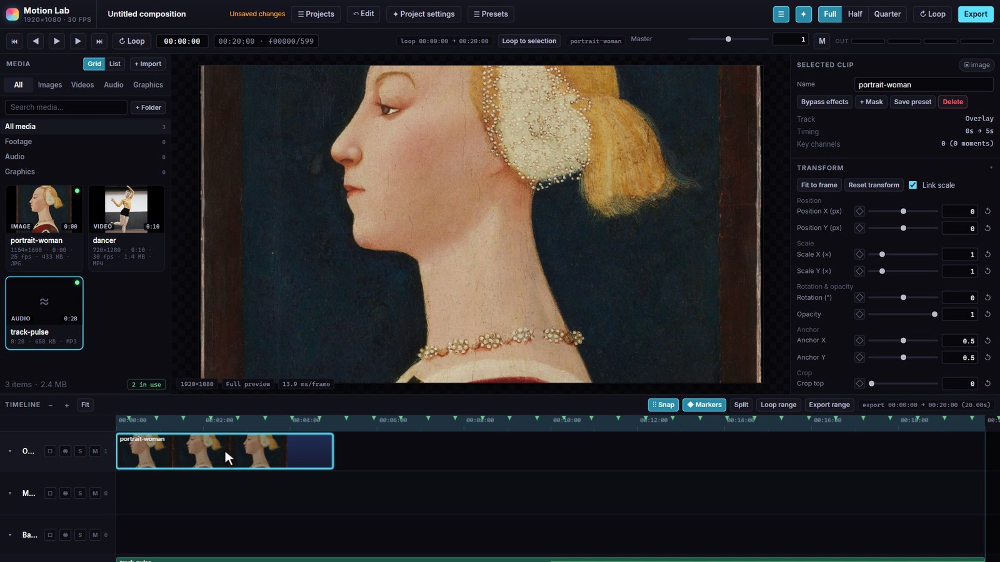
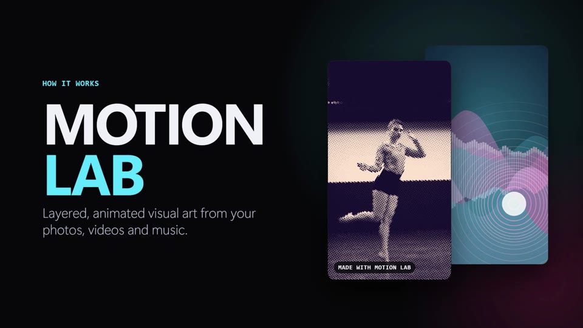
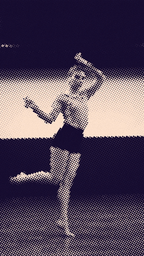
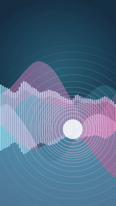
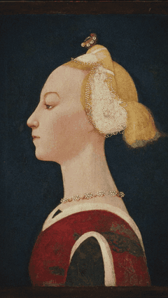
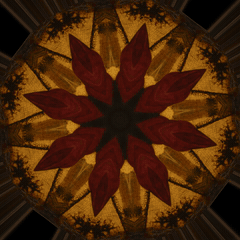
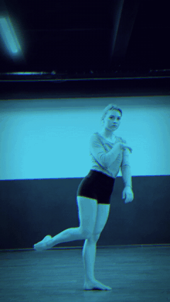
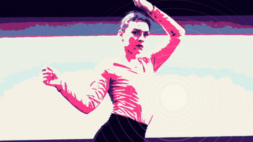

# Motion Lab

A desktop studio for turning photos, video clips and music into layered, animated visual art: music visualisers,
stylised clips, animated stills and loops. It has a multitrack timeline, keyframes, 25 effects, masks, procedural
graphics and audio-reactive animation, and it exports video, GIF, PNG and whole project packages.

**Everything runs on your computer. No account, no API key, nothing is uploaded.**



<!-- videos:start -->
## See it in action

<p align="center"><a href="docs/videos/tutorial.mp4"></a><br><b>▶ <a href="docs/videos/tutorial.mp4">How it works</a></b> (0:53, with captions)</p>

**Made with Motion Lab, from public-domain portraits (The Met), a free Pexels clip and the music and graphics Motion Lab makes itself**

<table><tr>
<td width="33%" align="center"><a href="docs/videos/examples/dancer-halftone.mp4"></a><br><a href="docs/videos/examples/dancer-halftone.mp4">Halftone</a></td>
<td width="33%" align="center"><a href="docs/videos/examples/poster-audio-reactive.mp4"></a><br><a href="docs/videos/examples/poster-audio-reactive.mp4">Audio-reactive poster</a></td>
<td width="33%" align="center"><a href="docs/videos/examples/portrait-animated-photo.mp4"></a><br><a href="docs/videos/examples/portrait-animated-photo.mp4">Animated photograph</a></td>
</tr><tr>
<td width="33%" align="center"><a href="docs/videos/examples/portrait-kaleidoscope.mp4"></a><br><a href="docs/videos/examples/portrait-kaleidoscope.mp4">Kaleidoscope</a></td>
<td width="33%" align="center"><a href="docs/videos/examples/dancer-trails.mp4"></a><br><a href="docs/videos/examples/dancer-trails.mp4">Trails + RGB split</a></td>
<td width="33%" align="center"><a href="docs/videos/examples/dancer-bass-rings.mp4"></a><br><a href="docs/videos/examples/dancer-bass-rings.mp4">Bass-driven rings</a></td>
</tr></table>

Click any picture to play the video. Example sources: *Portrait of a Woman* by the Master of the Castello Nativity
([The Met](https://www.metmuseum.org/art/collection/search/437000)) and *Portrait of a Young Man* by Biagio d'Antonio
([The Met](https://www.metmuseum.org/art/collection/search/435664)), both CC0; "A Woman Dancing Gracefully" by [Pavel Danilyuk](https://www.pexels.com/video/a-woman-dancing-gracefully-6939968/) (Pexels licence); the music cue and the poster's graphics are generated by Motion Lab (`npm run sample-media`). The videos have no sound.
<!-- videos:end -->

## Install

You need:
- Windows 10 or 11 (it is built and tested on Windows 11)
- [Node.js](https://nodejs.org) 22.11 or newer
- [ffmpeg](https://ffmpeg.org/download.html) on your PATH (ffmpeg and ffprobe), for video export and for reading video
  and audio files
- Google Chrome or Microsoft Edge: the editor opens in your browser, and exports render every frame in Chrome or
  Edge (without a window)

The app has no dependencies and no build step: the server, the engine and the editor are plain JavaScript modules.

```
npm start
```

Then open http://127.0.0.1:5273. Other ways to start it:
- Double-click `Start Motion Lab.cmd`. It starts the server and opens the editor in your browser. The first time, it
  also runs `npm install` (that is only needed for the tests).
- `launch.vbs` opens the editor in its own Edge window, and stops the server when you close that window.
- `node server/index.js --port 8080 --open` uses another port and opens the browser.

Optional: `powershell -ExecutionPolicy Bypass -File make_shortcut.ps1` puts a **Motion Lab** shortcut on your Desktop
(it runs `launch.vbs`).

**Sample media (optional).** `npm run sample-media` makes a sample photo, a second still, two short video clips and a
28-second music cue. They are all generated by code (nothing is downloaded) and imported into the media library.
Then `npm run starters` builds the three starter projects around them. Together they take a few minutes and need
ffmpeg and Chrome or Edge. You can also start right away with your own files.

What each feature needs:

| Feature | Needs |
| --- | --- |
| Editing, preview, keyframes, effects, masks, audio analysis, saving, project packages | Node.js only |
| Video export, video frame extraction, audio decoding | ffmpeg and ffprobe on PATH |
| Video, GIF, PNG-sequence and still export | Chrome or Edge |

Motion Lab says at startup (and in **Projects → About Motion Lab**) which of these it found. The export dialog greys
out the formats this computer can't write.

## How to use it
1. **Import** photos, videos and music: drag them onto the **Media** panel, or click **+ Import**. Folders, search
   and a marker on every file the composition uses help you keep track. **Replace file** swaps a source and keeps
   every clip's timing, effects and keyframes. Missing files can be relinked.
2. **Start a composition**: **Projects → New…** (landscape, portrait, square or custom size, 24/25/30/60 fps), or
   **Projects → Starter projects…**:
   - **Audio-reactive poster** (portrait, 12 s): an aurora background, rings driven by the bass, bars driven by the
     mids, and a masked title.
   - **Stylised video reel** (landscape, 20 s): three cross-fading clips with halftone, frame stepping and wave
     treatments under a teal/orange grade.
   - **Animated photograph** (portrait, 15 s): a slow push-in with a drift, grain, vignette, scratches and a masked
     caption.

   To use your own photo or video, drop it from the media library onto a starter's "drop media here" clip, or select
   that clip and click **Choose file...** under **Source**. In the starters built by `npm run starters`, right-click a
   sample file in the library and choose **Replace file...**. Either way the clip keeps its timing, effects and
   keyframes.
3. **Timeline**: image, video, text, graphic, audio and adjustment layers, plus nested compositions. Move, trim,
   split (**S**), duplicate, reorder, lock, hide, solo and mute. Snapping covers clip edges, markers and the playhead.
   **←/→** step one frame, **Shift** steps ten.
4. **Inspector** (right): position, scale, rotation, opacity, anchor, crop and blend mode. **K** sets a keyframe on
   any number, including effect settings and mask shapes. Easing is linear, ease in/out, hold or your own Bézier
   curve, and the graph editor has draggable keys and handles.
5. **Effects**: 25 effects in five groups, each with its own seed:

   | Group | Effects |
   | --- | --- |
   | Colour | Exposure, contrast, temperature, tint, saturation, vibrance, fade, levels, curves, duotone, palette map, bloom |
   | Texture | Film grain, paper texture, scratches, vignette |
   | Graphic | Halftone, posterize, edge outlines, pixelate |
   | Motion | Trails, frame stepping, strobe, animated noise |
   | Distortion | Wave displacement, RGB offset, kaleidoscope, glitch |

   An adjustment layer applies its effects to every layer below it. Masks are rectangles, ellipses or freehand
   shapes, with roundness, feather and invert.
6. **Graphics**: gradients, shapes, particles, waveforms, frequency bars, rings, noise, grids and text. They have
   seeds, and you can animate, mask and connect them to the music like any other layer.
7. **Music**: an imported track is analysed for loudness, low/mid/high energy, onsets and suggested beats. Connect
   any of these to any number (bass to a shape's scale, highs to grain), with sensitivity, range, smoothing, attack
   and release. Live meters show what each connection drives. Beats are suggestions: the panel says when the tempo
   estimate is weak.
8. **Presets**: save effect stacks, animations, audio connections and whole compositions, export them as JSON and use
   them again.
9. **Preview**: **Full**, **Half** or **Quarter** (keys **1/2/3**). The quality changes only the preview's sharpness,
   never the timing, the framing or the export. **Space** plays. **?** (or **Projects → Keyboard shortcuts**) lists every shortcut.
10. **Save**: projects save automatically. After a crash, the next start offers the unsaved draft back. Undo and redo
    (**Ctrl+Z** / **Ctrl+Shift+Z**) cover everything, and one drag is one undo step.
11. **Export** (**Ctrl+E**):
    - Video with sound: MP4 (H.264 or H.265), WebM (VP9 or VP8), MKV (AV1), MOV (ProRes) or animated GIF.
    - PNG image sequence (a zip with the mixed sound beside it), or a single PNG still of any frame.
    - Project package: a `.mlab.zip` with the project and all its media, to move it to another computer.
    - You choose size, frame rate, quality and range. Every frame is rendered from the timeline, so a slow computer
      makes exactly the same file as a fast one, only later. Progress, ETA and Cancel are shown.

## Where exports go
When an export is done, click **Download** in the export dialog. Your browser saves the file to its download folder
(usually `Downloads`). A copy stays in `workspace\exports\<job>\out\` inside the app folder; export folders older than
7 days are removed when the server starts.

## Where your work is kept
Everything is in the `workspace\` folder next to the app. It is created empty on the first start.
- `workspace\projects\`: your projects (versioned JSON, plus crash-recovery drafts)
- `workspace\media\`: your imported files (the originals are never changed) with thumbnails and audio data
- `workspace\exports\`: export jobs
- `workspace\motion-lab.log`: errors

Use another folder with `--workspace <folder>` or the `MOTION_LAB_WORKSPACE` environment variable. Other settings:
`--port` / `MOTION_LAB_PORT` (default 5273), `--host` / `MOTION_LAB_HOST` (default 127.0.0.1), `MOTION_LAB_BROWSER` or
`CHROME_PATH` (the browser that renders exports), `MOTION_LAB_FFMPEG` and `MOTION_LAB_FFPROBE`. `launch.vbs` keeps
its logs and the Edge window's profile in `%LOCALAPPDATA%\MotionLab\`.

## How the preview and the export stay the same
The exporter does not have its own renderer. It opens Chrome or Edge without a window, loads `web/harness.html`
(which uses the same `core/render.js` as the editor), renders each frame at export size, and sends the frames to
ffmpeg. On top of that:
- Random effects use the seed and the position in the picture, never `Math.random()`, so a frame always looks the
  same.
- Effects that change over time read the frame's time on the timeline, so jumping to a frame gives the same picture
  as playing up to it.
- Sizes in pixels are scaled with the render size, so a quarter-size preview is a smaller version of the same picture.
- Audio smoothing is worked out for every frame before playback, so starting in the middle gives the same values.

## What's where
- `core/`: the engine, shared by the editor and the exporter.
  - `schema.js` (project format, defaults, time helpers), `document.js` (checking, repairing and upgrading projects),
    `math.js` (Bézier, seeded noise), `keyframes.js`, `channels.js` (which properties can be animated),
    `effectRegistry.js` (effect settings and ranges), `effects.js` (the pixel work), `graphics.js` (procedural
    layers), `render.js` (draws one frame), `audioAnalysis.js` (FFT, bands, onsets, beats), `audio.js` (audio
    connections and mixing).
- `web/`: the editor (plain JavaScript modules, no bundler): `main.js` (start, shortcuts, autosave), `store.js`
  (project, selection, undo), `preview.js`, `playback.js`, `timeline.js`, `media.js`, `api.js`, `harness.js` +
  `harness.html` (the page the exporter renders in), and `ui/` (library, inspector, graph editor, presets, dialogs,
  export dialog).
- `server/`: the local server, built only on Node's own modules: `index.js` (start and static files), `routes.js`
  (the JSON API), `workspace.js`, `media.js` (ffmpeg/ffprobe, probing, thumbnails, zip), `exporter.js` (export
  jobs), `cdp.js` (drives Chrome/Edge over the DevTools protocol), `http.js`.
- `scripts/`: sample media and starter projects, the checks below, the look-set tools, and `launch-desktop.mjs`
  (used by `launch.vbs`).
- `tests/engine.test.js`: the unit tests.
- `Start Motion Lab.cmd`, `launch.vbs`, `make_shortcut.ps1`, `motion-lab.ico`: starting the app and its shortcut.

## Tests
```
npm ci
npm test
npm run check
```
`npm test` runs 71 unit tests: the same seed gives the same noise, the same frame renders identically twice,
pixel-sized effects scale with the render size, exports read each clip's own source frames, projects survive a save-and-load round trip, broken projects are
repaired instead of crashing, keyframe easing, audio analysis and the audio connection curves. `npm run check`
type-checks `core/` and `server/` with TypeScript (JSDoc types; nothing is built).

The end-to-end checks need ffmpeg, Chrome or Edge and the sample media (`npm run sample-media` and
`npm run starters` first). Each one starts its own server.
- `npm run verify:render` (57 checks): builds a composition that uses every layer type, every effect group, masks,
  an adjustment layer and audio connections; exports a 4-second 1080×1920 MP4 and checks its frames, length and
  sound; checks that an exported frame is pixel-identical to a freshly rendered one; checks that the preview
  quality can't change an export; checks that a half-size export is the full-size one scaled down and that a
  trimmed video clip exports its own source frames; checks that a photo or video of another shape than the
  composition is cover-fitted, not stretched; and exports a PNG sequence, a still and a project package,
  and cancels an export.
- `npm run verify:starters` (15 checks): opens each starter project and checks that it loads cleanly and moves.
- `npm run verify` runs both.
- `npm run smoke` (53 checks): drives the real editor in a browser: imports media, builds and animates a
  composition, adds effects, masks and audio connections, saves, reloads and checks that everything came back,
  exports a video, checks that a video clip stays on screen while the preview plays, after a pause and when
  scrubbing, and that photos and videos keep their proportions in the preview. It saves screenshots to `screenshots\`.
- `npm run screenshots` saves a screenshot of each starter project to `screenshots\`.

`npm run verify` and `npm run smoke` leave their exports in `workspace\exports\`. `npm run reset` empties the media
library and the projects in the workspace and builds the sample media and starter projects again; it deletes your own
imported media too (`--keep-media` keeps it).

### Rendering a look set from a folder of photographs
`scripts/generate-looks.mjs` applies up to 50 ready-made looks (film, print, distortion, texture, light and particle
treatments) to photos from a folder you choose, and saves one PNG per look. It builds one composition with every
look in its own 2-second slot and sends it to the app's normal export, so every output is made by the same renderer
as the preview.

```
npm start -- --port 5470
node scripts/generate-looks.mjs --source "<folder of photos>" --count 50 --width 1080 --height 1350
```

The second command runs in another terminal. Outputs go to `Pictures\Motion Lab\look-set` in your user folder
(`--out <folder>` changes that), with a `_meta\` folder holding a contact sheet, a README and a CSV index. The other
look-set tools take the same `--source` and/or `--dir <look set folder>`:

| Script | What it does |
| --- | --- |
| `scripts/make-comparisons.mjs` | Before/after pairs: the same photo through the same composition, with and without the look (needs the default 1080×1350 size) |
| `scripts/verify-looks.mjs` | Checks a full 50-look set: count, duplicates, sizes, and which effects were used |
| `scripts/report-looks.mjs` | Measures each output's brightness, to catch a frame that rendered black |
| `scripts/list-looks.mjs` | Sizes and dimensions of every output |
| `scripts/diagnose-look.mjs` | Renders one look (`--look <n>`) with more and more of its effects, to find the one that goes wrong |

## Limits
- Video export needs Chrome or Edge, because that is where frames are rendered. Without one you can still edit,
  preview and download project packages.
- Which videos play depends on the browser's codecs. H.264 MP4 and WebM are safe. A file the browser can't read is
  reported, and you can replace it or convert it.
- Exports are frame-exact but not real time. A 1080×1920 frame with halftone, grain, an adjustment layer, particles
  and trails takes about half a second, so a one-minute video takes a few minutes. Use the Quarter preview while
  editing.

## Credits
- No third-party code is used at runtime: the server uses only Node's own modules, and the editor uses the browser's
  DOM and Canvas 2D.
- Development only (installed by `npm ci`, not shipped): [TypeScript](https://www.typescriptlang.org/) (Apache-2.0),
  [Vitest](https://vitest.dev/) (MIT) and [@types/node](https://www.npmjs.com/package/@types/node) (MIT).
- External programs: [ffmpeg](https://ffmpeg.org/) (LGPL/GPL) encodes and decodes, and Chrome or Edge renders
  export frames.
- The sample photo, clips and music are generated by `scripts/make-sample-media.mjs`; no media files are included.
- Footage in the tutorial and examples (`docs/`): *Portrait of a Woman* by the Master of the Castello Nativity and
  *Portrait of a Young Man* by Biagio d'Antonio, [The Metropolitan Museum of Art](https://www.metmuseum.org/art/collection/search/437000)
  ([second portrait](https://www.metmuseum.org/art/collection/search/435664)) (CC0), and "A Woman Dancing
  Gracefully" by [Pavel Danilyuk](https://www.pexels.com/video/a-woman-dancing-gracefully-6939968/)
  ([Pexels licence](https://www.pexels.com/license/)). The music that drives the audio-reactive examples is the cue
  Motion Lab generates itself; the videos have no sound.

## Licence

MIT, see [LICENSE](LICENSE).
